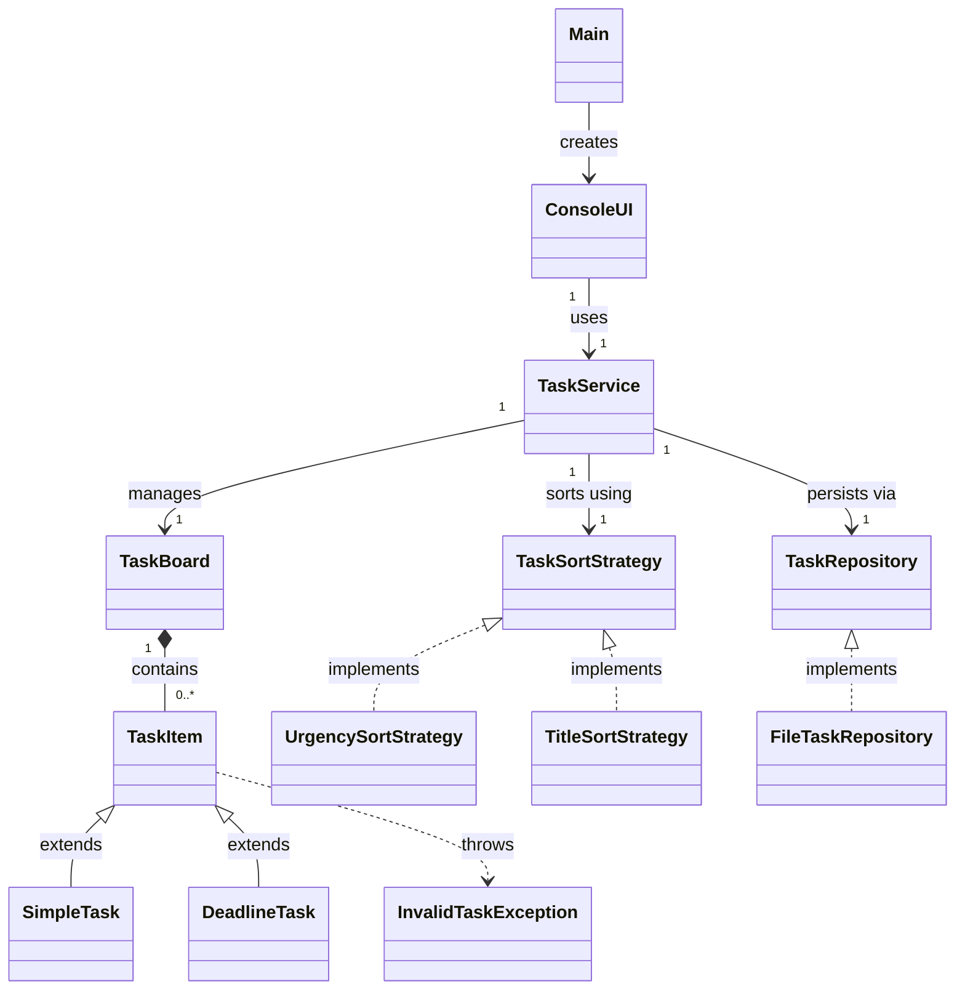

# TaskFlow – Java OOP Console Task Manager

A clean, object-oriented Java console application built with Maven for **Prog 2 – Java OOP Projectwork Assignment**.

## 1. Problem Statement
Students and busy individuals often juggle both open-ended tasks (e.g., *read notes*) and strict deadline-driven assignments (e.g., *submit homework by 2026-11-29*). **TaskFlow** solves this problem by modeling both task types under a unified board, calculating dynamic urgency scores based on priority and approaching deadlines, letting users switch sorting views at runtime, and preserving tasks between application runs.

## 2. Prerequisites
- **Java 17** or newer
- **Apache Maven 3.8+**

## 3. Build, Test, and Run Instructions

From a clean checkout of the repository:

```bash
# Compile and run all JUnit 5 tests
mvn test

# Compile and start the console application
mvn compile exec:java
```

## 4. Sample Usage
```text
=== TaskFlow: My Personal Tasks ===

--- MENU (Sort: Urgency (Highest First)) ---
1. List tasks
2. Add simple task
3. Add deadline task
4. Mark task as done
5. Delete task
6. Switch sorting strategy
7. Save tasks
0. Save and exit
Choose an option: 3
Task title: Submit Prog 2 Project
Priority (1-5): 5
Due date (YYYY-MM-DD): 2026-11-29
Deadline task added.
```

## 5. Implemented Technical Requirements

| Requirement | Implementation in TaskFlow |
|---|---|
| **Encapsulation** | Private fields across all domain classes (`TaskItem`, `DeadlineTask`, `TaskBoard`) with validating constructors and controlled getters/methods. |
| **Abstraction** | Abstract base class `TaskItem` plus interfaces `TaskSortStrategy` and `TaskRepository`. |
| **Inheritance & Polymorphism** | `SimpleTask` and `DeadlineTask` extend `TaskItem` and override `calculateUrgencyScore()`, `getTaskType()`, `toStorageString()`, and `formatDetails()` with different runtime behavior. |
| **Relationships** | Composition (`TaskBoard` `1` *-- `0..*` `TaskItem`), Association (`TaskService` -> `TaskBoard`, `TaskRepository`, `TaskSortStrategy`; `ConsoleUI` -> `TaskService`). |
| **Collections & Generics** | Generic `ArrayList<TaskItem>` in `TaskBoard`, sorted with lambda expression (`UrgencySortStrategy`) and `Comparator.comparing` (`TitleSortStrategy`). |
| **Exceptions** | Custom checked exception `InvalidTaskException` enforcing domain rules (non-empty title, no semicolon, priority 1–5, valid index/date) plus graceful handling of `IOException` and parse errors. |
| **Persistence** | `FileTaskRepository` reads and writes tasks to `data/tasks.txt` using `try-with-resources` (`BufferedReader` / `BufferedWriter`). |
| **Testing** | Automated JUnit 5 test suite in `src/test/java/com/taskflow/TaskServiceTest.java`. |

## 6. Design Pattern: Strategy Pattern
- **Problem solved:** Users need to view their tasks in different orders (e.g., by calculated urgency or alphabetically by title) without cluttering `TaskService` with `if/else` sorting branches.
- **Participating classes:**
  - **Strategy interface:** `com.taskflow.service.TaskSortStrategy`
  - **Concrete strategies:** `UrgencySortStrategy`, `TitleSortStrategy`
  - **Context:** `com.taskflow.service.TaskService`
- **Benefit:** Sorting behavior can be swapped dynamically at runtime via `TaskService.setSortStrategy(...)`, and new sorting rules (e.g., by due date or status) can be added without modifying existing service or UI code (Open/Closed Principle).

## 7. UML Class Diagram
Editable source: [`docs/uml.mmd`](docs/uml.mmd) | Viewable vector diagram: [`docs/uml.svg`](docs/uml.svg) | User stories: [`docs/user_stories.md`](docs/user_stories.md)



## 8. Design Decisions & Known Limitations
- **Layered package structure:** Separated into `domain`, `service`, `persistence`, and `ui` packages so the persistence mechanism or UI can be replaced independently.
- **Plain-text persistence:** Semicolon-delimited text keeps the project zero-dependency and human-readable; as a limitation, task titles cannot contain `;` (enforced via `InvalidTaskException`).
- **Single board:** Currently operates on one default `TaskBoard` per session; multi-board management could be added in a future release.

## 9. Contributor
- **Péter Szerbacsics**
